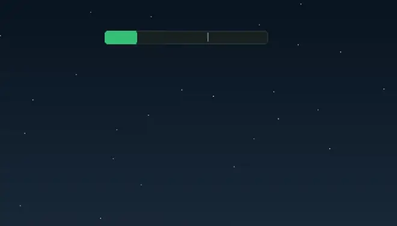
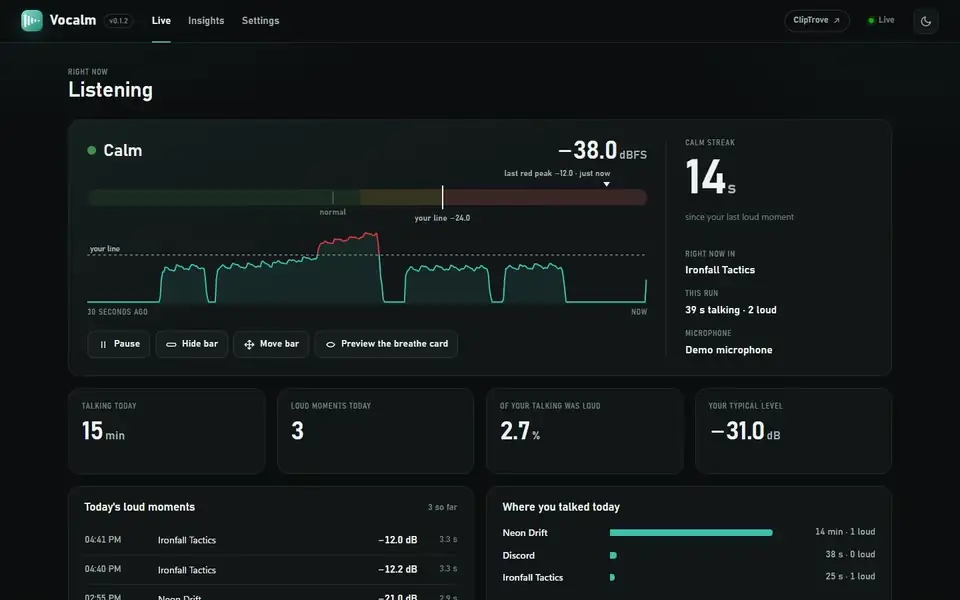
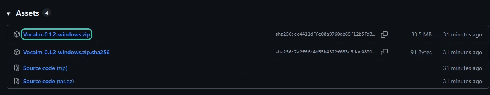
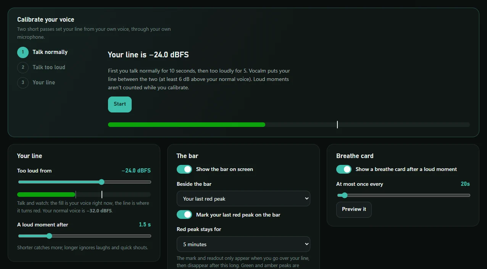
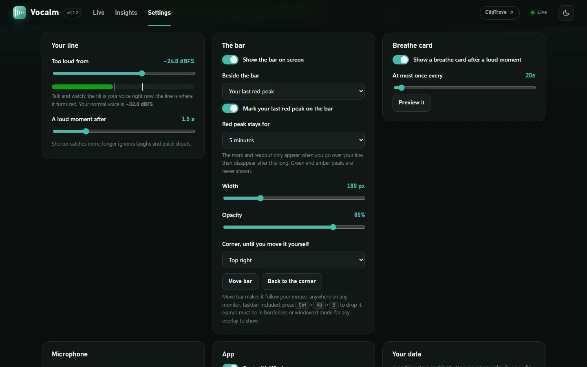
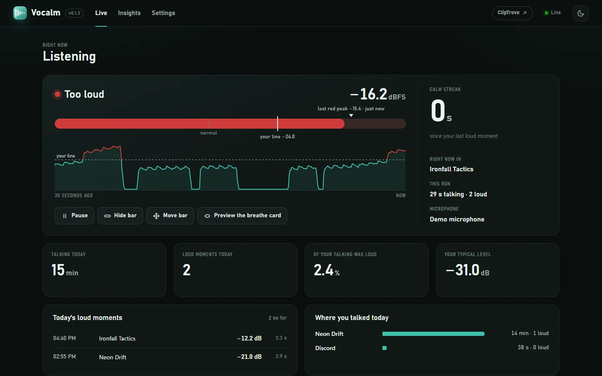
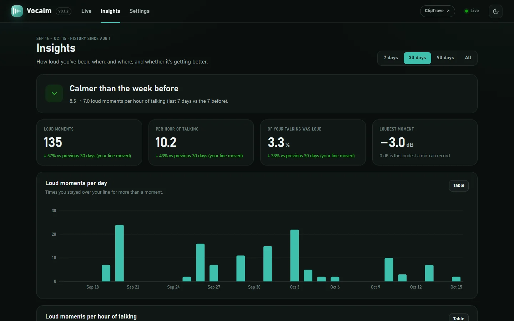
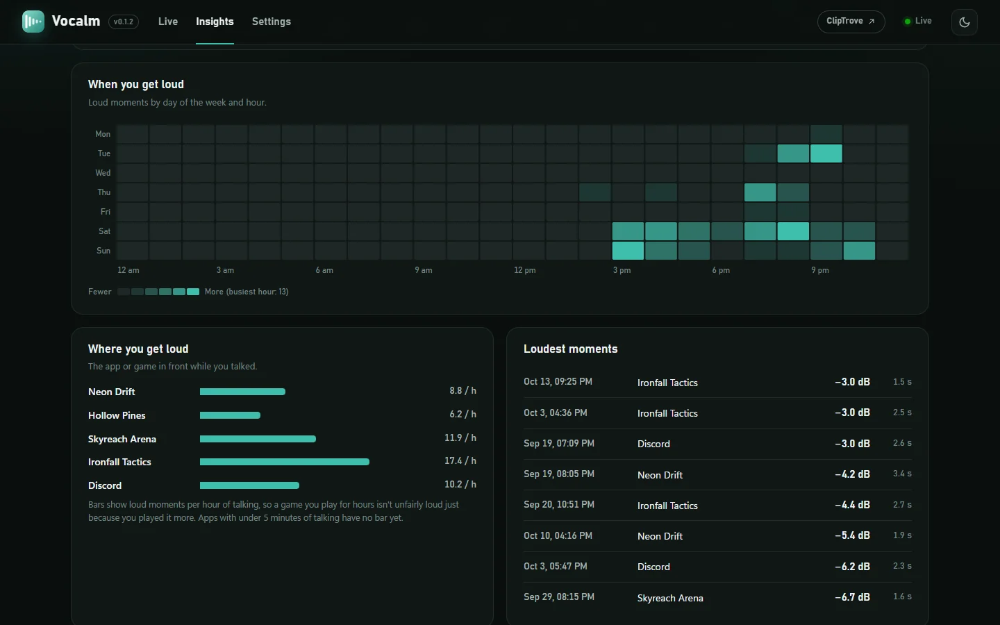

<p align="center">
  
</p>

<h1 align="center">Vocalm</h1>

<p align="center">
  <b>Hear yourself before your friends do.</b><br>
  A small bar over your game turns red the moment you get too loud on Discord and nudges you to breathe,<br>
  and a dashboard on your PC shows when and where you get loud, so you can actually get calmer.
</p>

<p align="center">
  <a href="https://github.com/Orio-03/Vocalm/releases/latest"><b>Download for Windows</b></a>
  ·
  <a href="https://orio-03.github.io/Vocalm/">Website</a>
  ·
  <a href="#get-started">Get started</a>
  ·
  <a href="#questions">Questions</a>
  ·
  <a href="PRIVACY.md">Privacy</a>
  ·
  <a href="CHANGELOG.md">Changelog</a>
</p>

<p align="center">
  <a href="https://github.com/Orio-03/Vocalm/releases/latest"></a>
  <a href="https://github.com/Orio-03/Vocalm/actions/workflows/tests.yml"></a>
  
  <a href="LICENSE.md"></a>
</p>

<p align="center">
  
</p>

<p align="center"><sub>The real bar in the corner of a game: calm, getting close, too loud, then a breathe card.</sub></p>

## What it does

- **Tells you instantly.** Green while you're calm, amber as you get close to your line, red and a little bigger the moment you're over it. You catch it in the corner of your eye without looking away from the game.
- **Never gets in the way.** Clicks go straight through the bar, it can never take focus from your game, and it stays out of Alt-Tab. Put it anywhere on any monitor, the taskbar included.
- **Shows how far over you went.** After you go red, a needle and a readout (`● -11.8 dB`) show your last red peak, then clear away after a time you choose. Calm and amber moments are never shown.
- **A nudge, not a nag.** Stay loud for more than a moment and a small *breathe* card slides in for a few seconds. A laugh doesn't count. It never makes a sound.
- **Loud the way ears hear it.** Levels are A-weighted, like a dB(A) meter, so a high-pitched shout counts as loud as it sounds.
- **Shows the patterns.** A dashboard on your own PC: your voice live, today's loud moments, this week against the last, the hours you get heated and the games that set you off.
- **Private by design.** No audio is ever recorded, no account, no uploads. [Privacy](PRIVACY.md) has the details.

## See it



<sub>Every picture here comes from Vocalm's demo mode: a scripted voice and two months of made-up history in made-up games.</sub>

<a id="get-started"></a>

## Get started

### 1. Download

Open the [**latest release**](https://github.com/Orio-03/Vocalm/releases/latest). Under **Assets**, click **`Vocalm-…-windows.zip`**.



### 2. Unzip it and start Vocalm

1. Right-click the zip and choose **Extract All…**. Pick a folder you'll keep, for example `Documents\Vocalm`.
2. Open that folder and double-click **`Vocalm.exe`**.

A small bar appears in the top-right corner of your main screen, a tray icon appears by the clock, and your browser opens the dashboard at **http://127.0.0.1:48680**. That address only works on your own PC.

> [!NOTE]
> **Seeing "Windows protected your PC"?** Windows shows this for new apps that haven't paid for a code-signing certificate. Click **More info**, then **Run anyway**. You only need to do this once. Only download Vocalm from this page's [Releases](https://github.com/Orio-03/Vocalm/releases).

### 3. Calibrate your voice

In the dashboard, open **Settings** and click **Start** under *Calibrate your voice*. Talk normally for 10 seconds, then at the volume a friend would wince at for 5. Vocalm puts your line between the two, through your own microphone.



> [!TIP]
> For the loud pass, don't do your loudest scream: Vocalm sets the line a little under it, so a full scream makes the line too forgiving. Aim for "this is already too much".

### 4. Put the bar where you want it

Press <kbd>Ctrl</kbd>+<kbd>Alt</kbd>+<kbd>B</kbd> (or **Move bar** in the dashboard or the tray menu). The bar follows your mouse, anywhere on any monitor, even over the taskbar. Press <kbd>Ctrl</kbd>+<kbd>Alt</kbd>+<kbd>B</kbd> again to drop it there.

| Hotkey | What it does |
| --- | --- |
| <kbd>Ctrl</kbd>+<kbd>Alt</kbd>+<kbd>M</kbd> | Pause or resume |
| <kbd>Ctrl</kbd>+<kbd>Alt</kbd>+<kbd>B</kbd> | Move the bar; <kbd>Ctrl</kbd>+<kbd>Alt</kbd>+arrows nudge it a pixel at a time |
| <kbd>Ctrl</kbd>+<kbd>Alt</kbd>+<kbd>Q</kbd> | Quit Vocalm |

> [!IMPORTANT]
> Games have to run in **borderless** or **windowed** mode for the bar to show over them. No overlay can draw over exclusive fullscreen. Borderless looks the same and is usually just as fast.

### 5. Start with Windows (optional)

Turn on **Start with Windows** in Settings or in the tray menu, so Vocalm is always listening when you play and **http://127.0.0.1:48680** always works. You can bookmark it.

## Using Vocalm

### The bar

| You see | It means |
| --- | --- |
| A green fill | You're talking calmly |
| An amber fill | You're within 6 dB of your line |
| A red bar, slightly bigger | You're over your line right now |
| A needle and `● -11.8 dB` | How far over your line you went last time. It clears after 5 minutes, or the time you choose |
| A pause sign | Monitoring is paused (<kbd>Ctrl</kbd>+<kbd>Alt</kbd>+<kbd>M</kbd>) |
| A blue grip | The bar is following your mouse to be moved |

If you stay over your line for 1.5 seconds (you can change this), it counts as a **loud moment** and a small breathe card slides in for a few seconds. It won't show again for 30 seconds, so a heated round doesn't turn into nagging.

<details>
<summary><b>Change what's shown beside the bar, and for how long</b></summary>

<br>

**Settings → The bar**: show your last red peak, your calm streak (`calm 12m`) or nothing beside the bar; turn the needle on or off; and choose how long a red peak stays: 1, 5, 10 or 15 minutes, never, or any number of minutes. You can also change the bar's width, opacity and starting corner.



</details>

### The dashboard

**Live** shows your voice as it happens: whether you're calm, close or too loud, the last 30 seconds traced against your line, your calm streak, which game is in front, and today's loud moments.



**Insights** shows whether you're getting calmer: this week against the last, loud moments per day, and loud moments **per hour of talking**, the fair comparison that doesn't go up just because you played longer.

<details>
<summary><b>See the Insights page</b></summary>

<br>



</details>

<details>
<summary><b>See when and where you get loud</b></summary>

<br>

A heatmap of loud moments by weekday and hour, the games you get loudest in (per hour of talking, so a game you play more isn't unfairly loud), and your loudest moments.



</details>

## How it measures

Vocalm listens to one microphone (by default *SteelSeries Sonar - Microphone*, which is exactly what Discord sends) and measures its level in dBFS, where 0 is the loudest a microphone can record. It never records or stores audio.

- **Loudness is weighted the way ears hear it** (A-weighting, as in dB(A)). Hearing is far more sensitive around 2-4 kHz than to the low end of a voice, so a high-pitched shout counts as loud as it sounds, not just as loud as its raw energy.
- **Your line** is where the bar turns red. Calibration puts it 45% of the way from your normal voice to your too-loud voice, and never closer than 6 dB above your normal voice, because speech swings that much between words.
- **A loud moment** is staying over your line for 1.5 seconds in a row. A laugh or a single shout turns the bar red but isn't counted.
- **Talking** starts 18 dB under your normal voice, so keyboard clatter, breathing and room noise don't count as talking time.
- **Loud moments per hour of talking** compares days and games fairly. Vocalm adds up your talking time minute by minute and per app to work it out.

<a id="questions"></a>

## Questions

<details>
<summary><b>The bar doesn't show over my game</b></summary>

The game is in exclusive fullscreen, which nothing can draw over. Switch it to **borderless** (sometimes called *windowed fullscreen*) in its video settings.

</details>

<details>
<summary><b>Will it slow my game down?</b></summary>

No. Vocalm uses about 0.2% of a modern processor and only redraws the bar when your level changes. It can't take focus, so it can't interrupt you either.

</details>

<details>
<summary><b>Which microphone does it listen to? Can Discord use it at the same time?</b></summary>

Whichever you pick in **Settings → Microphone**. With SteelSeries Sonar it defaults to Sonar's microphone, the processed signal Discord sends, so the bar shows what your friends actually hear. Discord and Vocalm share the microphone without trouble.

</details>

<details>
<summary><b>High-pitched sounds don't seem to register</b></summary>

Vocalm already weights levels the way ears hear them. If a squeal still barely moves the bar, your microphone software's noise cancellation (Sonar's ClearCast, for example) is probably removing it before Discord gets it, so your friends hear it quieter too. To check, pick your raw microphone in Settings and compare.

</details>

<details>
<summary><b>Does it record what I say?</b></summary>

Never. Sound becomes a level about 90 times a second and is thrown away straight after. Vocalm keeps how loud you were and when, and the name of the program in front if you allow it, never window titles.

</details>

<details>
<summary><b>Where is my data, and how do I remove Vocalm?</b></summary>

Settings and history are in `%LOCALAPPDATA%\Vocalm`. To remove Vocalm: turn off Start with Windows if it's on, quit it from the tray icon, then delete the folder you unzipped it into and `%LOCALAPPDATA%\Vocalm`. You can export your loud moments as CSV from Settings first.

</details>

<details>
<summary><b>Is it free?</b></summary>

Yes, for personal and other noncommercial use. See [License](#license).

</details>

## Where it's heading

Vocalm notes which game is in front while you talk, minute by minute. That lines up with [Cliptrove](https://github.com/Orio-03/Cliptrove)'s clips, which are timed and named by game, so a later version can show how loud you were in each clip, compare your voice across games, and predict whether you're getting calmer. The dashboard already links to Cliptrove when it's running.

## For developers

Vocalm is Python (with numpy, sounddevice, pystray and Pillow) plus HTML, CSS and JavaScript for the dashboard. With [Python](https://www.python.org/downloads/) 3.10 or newer:

```
git clone https://github.com/Orio-03/Vocalm.git
cd Vocalm
python -m pip install -r requirements.txt
python -m vocalm
```

<details>
<summary><b>Tests, demo mode, the pictures, and building the app</b></summary>

<br>

```
python -m unittest discover -s tests                     # the tests (they also run on every push)
python -m vocalm --demo                                  # a scripted voice and made-up history, on port 48690
python packaging/media/make_media.py                     # every screenshot and video in this README and on the site
python packaging/build_site.py                           # the website, in _site/
python -m pip install -r packaging/requirements-build.txt
python packaging/build_windows.py                        # dist/Vocalm/Vocalm.exe and the release zip
python packaging/smoke_test.py dist/Vocalm/Vocalm.exe    # start the built app and check it works
python packaging/install_local.py --autostart            # install it for this Windows user
```

`make_media.py` needs Node 22+, Chrome or Edge, and ffmpeg (`winget install Gyan.FFmpeg`). It films the real bar on your main monitor, so leave the screen alone for the half minute it takes.

</details>

## License

Vocalm is © 2026 Ayman Kandouli and is available under the [PolyForm Noncommercial License 1.0.0](LICENSE.md).

- **Free** to use, share and change for personal and other noncommercial purposes, as long as you keep the license notice.
- **Not allowed** without permission: selling it, or using it in a commercial product or service. To ask about commercial use, [open an issue](https://github.com/Orio-03/Vocalm/issues).

Vocalm isn't affiliated with Discord, SteelSeries or Microsoft.
