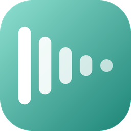

<p align="center">
  
</p>

<h1 align="center">Vocalm</h1>

<p align="center">
  <b>Keeps your voice in check while you game.</b><br>
  A small bar on your screen that tells you, the moment it happens, when you're getting too loud for your friends,
  and a dashboard that shows whether you're actually getting calmer.
</p>

<p align="center">
  <a href="https://github.com/Orio-03/Vocalm/releases/latest"><b>Download for Windows</b></a>
  ·
  <a href="#get-started">Get started</a>
  ·
  <a href="PRIVACY.md">Privacy</a>
  ·
  <a href="CHANGELOG.md">Changelog</a>
</p>

<p align="center">
  <a href="https://github.com/Orio-03/Vocalm/releases/latest"></a>
  <a href="https://github.com/Orio-03/Vocalm/actions/workflows/tests.yml"></a>
  
  <a href="LICENSE.md"></a>
</p>

## What it does

- **A bar that never gets in the way.** Green while you're calm, amber as you get close to your line, red (and a
  little bigger) when you're over it. Clicks go straight through it, it can never take focus from your game, and it
  stays out of Alt-Tab.
- **A nudge, not a nag.** Stay loud for more than a moment and a small *breathe* card slides in for a few seconds.
  Laughs and one-off shouts don't count; staying loud does. It never makes a sound.
- **A dashboard on your own PC** at `http://127.0.0.1:48680`: a live meter with your last 30 seconds, your calm
  streak, today's loud moments, and *Insights*: how this week compares with the last, when you get loud (by day and
  hour), and which games you get loudest in.
- **Calibrated to your voice.** Talk normally for 10 seconds, then too loudly for 5, and Vocalm sets your line
  between the two, right from the dashboard.
- **A tray icon** that turns red while you're loud and grey while paused, with pause, move bar, start with Windows
  and quit.

<a id="get-started"></a>

## Get started

1. Download the zip from the [latest release](https://github.com/Orio-03/Vocalm/releases/latest), unzip it anywhere,
   and double-click **Vocalm.exe**
   (or run `python packaging/install_local.py --autostart` from a source checkout to install it properly).
2. Your browser opens the dashboard. Go to **Settings → Calibrate your voice**.
3. Play. Games need to run in **borderless or windowed** mode: no overlay can draw over exclusive fullscreen.

| Hotkey | |
| --- | --- |
| <kbd>Ctrl</kbd>+<kbd>Alt</kbd>+<kbd>M</kbd> | pause / resume |
| <kbd>Ctrl</kbd>+<kbd>Alt</kbd>+<kbd>B</kbd> | move the bar: it follows your mouse until you press it again (<kbd>Ctrl</kbd>+<kbd>Alt</kbd>+arrows nudge it) |
| <kbd>Ctrl</kbd>+<kbd>Alt</kbd>+<kbd>Q</kbd> | quit |

## How it measures

Vocalm listens to one microphone (by default *SteelSeries Sonar - Microphone*, the processed signal Discord sends)
and measures its level in dBFS, where 0 is the loudest a microphone can record. It never records or stores audio.

- **Loudness is weighted the way ears hear it** (A-weighting, as in dB(A)). Hearing is far more sensitive around
  2-4 kHz than to the low end of a voice, so a high-pitched shout counts as loud as it sounds, not as loud as its
  raw energy.

- **Your line** is where the bar turns red. Calibration puts it 45% of the way from your normal voice to your
  too-loud voice, and never closer than 6 dB above your normal voice, because speech swings that much between words.
- **A loud moment** is staying over your line for 1.5 seconds in a row (adjustable).
- **Talking** starts 18 dB under your normal voice, so keyboard clatter, breathing and room noise don't count as
  talking time or show up as your last peak.
- **Your last red peak** is the loudest point of the last time you went over your line. The bar marks it with a
  small needle and shows it beside the bar, then clears it after the time you choose (5 minutes unless you change
  it). Green and amber peaks are never shown: the bar only speaks up when you've been too loud.
- **Loud moments per hour of talking** is the fair comparison between days and games: it doesn't go up just because
  you played longer. Vocalm adds up your talking time minute by minute and per app to work it out.

## Your data

Everything stays on your PC, in `%LOCALAPPDATA%\Vocalm`: your settings and a small SQLite database of loud moments
and talking time. No account, no uploads, no audio. See [PRIVACY.md](PRIVACY.md).

The first time it starts, Vocalm brings over the settings and logs of the *Loud Mic* script it grew out of.

## Where it's heading

Vocalm notes which app or game is in front while you talk, minute by minute. That lines up with
[ClipTrove](https://github.com/Orio-03/Cliptrove)'s clips, which are timed and named by game, so a later version can
show how loud you were in each clip, compare your voice across games, and tell whether you're likely to improve.
The dashboard already shows a link to ClipTrove when it's running.

## Building from source

```
python -m pip install -r requirements.txt -r packaging/requirements-build.txt
python -m unittest discover -s tests          # the tests
python -m vocalm                               # run from source (or double-click Vocalm.pyw)
python packaging/make_icons.py                 # redraw the icons after changing vocalm/icons.py
python packaging/build_windows.py              # dist/Vocalm/Vocalm.exe and the release zip
python packaging/smoke_test.py dist/Vocalm/Vocalm.exe
python packaging/install_local.py --autostart  # install for this user
```

Windows 10 or 11, Python 3.10 or newer.

## License

[PolyForm Noncommercial 1.0.0](LICENSE.md): use it, read it and change it for anything noncommercial.
